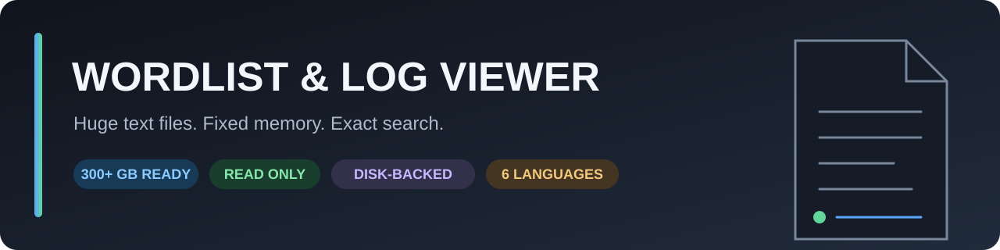

# Wordlist & Log Viewer

[Türkçe README](README.tr.md)

Wordlist & Log Viewer is a read-only Windows x64 application for opening and exact-searching extremely large plain-text logs, dictionaries, wordlists, and other line-oriented text files without loading the complete file into memory. It is designed for files hundreds of gigabytes in size and has been developed with 300+ GB inputs in mind.

**Best for:** archived application/server logs, exported audit trails, password dictionaries, wordlists, line-delimited JSON, traces, and other huge text datasets.

**Not intended for:** live log tailing, remote log collection, editing, or structured analytics such as JSON-field queries and dashboards.

## Highlights

- Continuous virtual scrolling with a small, fixed memory footprint.
- Byte offset, byte length, and line information for every visible row.
- Forward/backward exact search and a disk-backed **Find All** scan.
- Exact match count with paginated offsets for the entire file.
- Optional line-navigation index and **Go to line** support.
- Bookmarks, location history, and session restoration.
- Normal, invisible-character, and hexadecimal views.
- Safe inspection of exceptionally long lines.
- Live throughput, scanned amount, ETA, and bottleneck metrics.
- No installer and no modification of the source file.

## Languages

English is the default. The interface can be changed live and remembers the selection:

- English
- Türkçe
- Español
- Français
- Deutsch
- Português (Brasil)

All interface controls, status messages, errors, viewer headers, search results, performance information, and the long-line window are localized.

## Download and run

1. Download `WordlistViewer.exe` from the latest GitHub Release or use `release/WordlistViewer.exe` from this repository package.
2. Run it on 64-bit Windows.
3. Select **Open File…** or drag a supported file onto the window.

Common extensions: `.txt`, `.lst`, `.dic`, `.wordlist`, `.log`, `.out`, `.trace`, `.jsonl`, and `.ndjson`. The **All files** option can open any line-oriented text file.

The application targets .NET Framework 4.8 and Windows x64.

## Full-file search

Enter an exact query and select **Find All**, or press `Ctrl+Shift+F`. Wordlist Viewer scans the file sequentially, counts every occurrence, and stores result offsets in a temporary disk-backed index. Results are displayed in pages of 500, so the match list does not consume unbounded RAM.

Each stored offset uses 8 bytes. For example, one million results use about 8 MB of temporary disk space. The scan preserves a 2 GB safety reserve on the system drive and removes temporary result files after cancellation or exit.

## Build from source

Requirements:

- Windows 10 or Windows 11 x64
- .NET Framework 4.8 Developer Pack or Visual Studio with .NET desktop development tools
- Windows PowerShell 5.1 or newer

Build and test:

```powershell
powershell -ExecutionPolicy Bypass -File .\scripts\build.ps1
powershell -ExecutionPolicy Bypass -File .\scripts\test.ps1
```

The application is written in C# and intentionally keeps external dependencies at zero. You can also open `WordlistViewer.csproj` in Visual Studio.

## Keyboard shortcuts

| Shortcut | Action |
|---|---|
| `Ctrl+O` | Open file |
| `Ctrl+F` | Focus search |
| `Ctrl+Shift+F` | Scan the entire file |
| `F3` / `Shift+F3` | Next / previous match |
| `Alt+Left` / `Alt+Right` | Navigate location history |
| `Ctrl+B` | Toggle bookmark |
| `Ctrl+Home` / `Ctrl+End` | Beginning / end of file |
| `Esc` | Cancel search or indexing |

## Project layout

```text
src/                  Application source
tests/                Engine and localization tests
scripts/              Reproducible build and test scripts
docs/                 Architecture and localization notes
.github/workflows/    Windows CI workflow
release/              Ready-to-run Windows x64 binary
```

See [CONTRIBUTING.md](CONTRIBUTING.md) before submitting a change. This project is available under the [MIT License](LICENSE).

## Support the project

If Wordlist & Log Viewer saves you time, you can optionally support its continued development with a crypto donation:

- **Asset:** Native USDC
- **Network:** Base Mainnet (chain ID `8453`)
- **Address:** [`0x82fc184297F6d4Ad845173Ab488F0845f9baE702`](https://basescan.org/address/0x82fc184297F6d4Ad845173Ab488F0845f9baE702)

Send only native USDC over the Base network and verify the network and full address before confirming a transfer. Crypto transfers cannot normally be reversed, and using an incompatible asset or network may result in loss. Donations are voluntary and do not purchase support, feature priority, services, or warranties.

